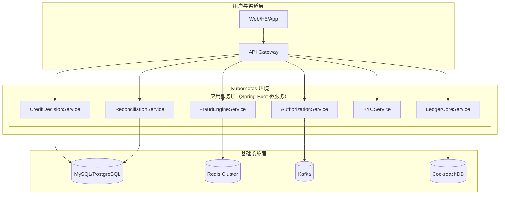
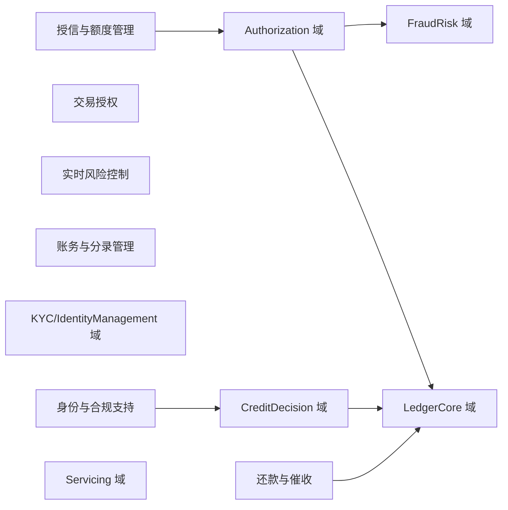
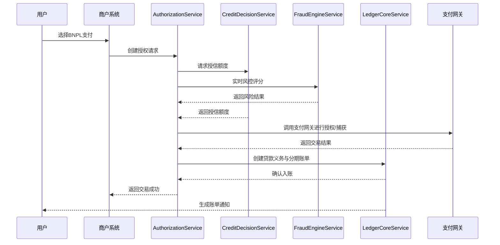
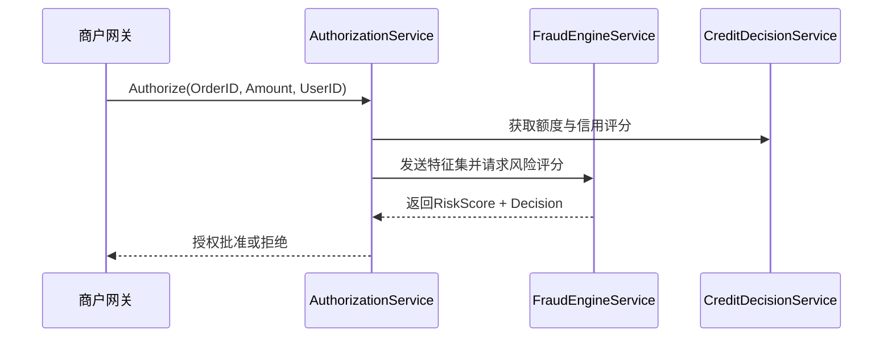
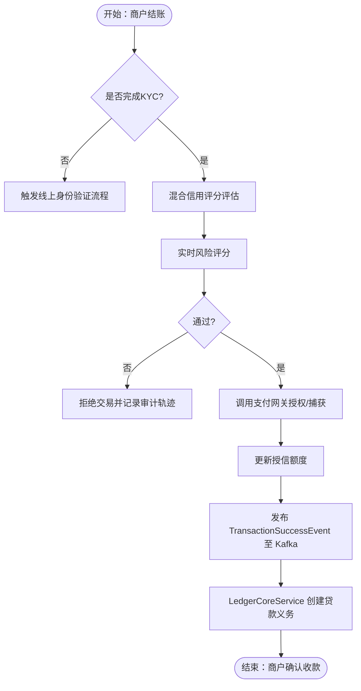
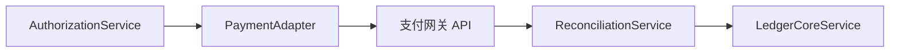
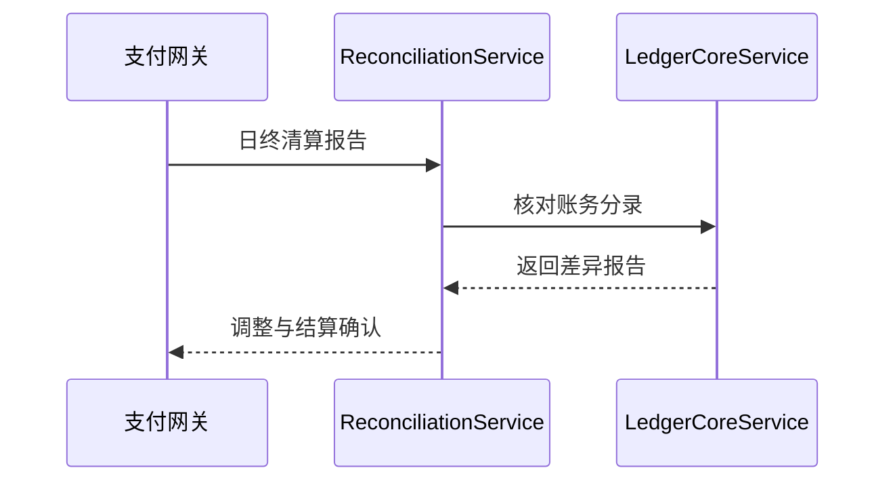

# 先享后付（BNPL）产品技术方案架构文档（含设计图）

## II.A 架构哲学：领域驱动设计与微服务

### 系统微服务架构图


---

## III. 领域驱动架构分解

### 领域上下文划分图（DDD Bounded Context）


---

## V.A 终端用户端到端流程（从商户结账到清算）

### 用户结账到清算流程时序图


---

## VI.B 业务时序图：预授权风险评分与决策



---

## VI.C 聚合流程图：支付授权与账务更新



---

## VII.A 信用卡核心系统集成策略

### 防腐层（ACL）架构图
```mermaid
graph TD
  Legacy[信用卡核心系统] --> ACL[Anti-Corruption Layer (SpringBoot)]
  ACL --> BNPL[BNPL微服务集群]
  BNPL --> Ledger[LedgerCoreService]
  BNPL --> Credit[CreditDecisionService]
  BNPL --> Auth[AuthorizationService]
```

---

## VII.B 支付网关集成策略

### 支付适配器模式图


---

## VII.C 清算与对账流程概览

